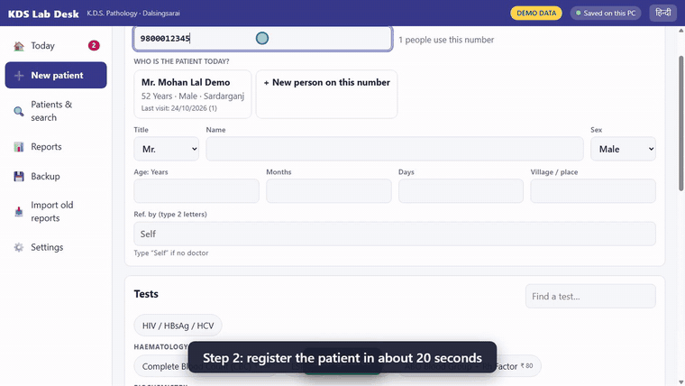

<p align="center">
  
</p>

<h1 align="center">KDS Lab Desk</h1>

<p align="center">
  <b>Free, offline pathology lab reporting software for Windows.</b><br>
  Register a patient, type the results, approve, and send the PDF report on WhatsApp.<br>
  Works without internet. English and Hindi. Made for small labs.
</p>

<p align="center">
  <a href="https://github.com/santoshray02/kds-lab-desk/releases/latest"><b>⬇ Download for Windows</b></a>
  &nbsp;·&nbsp;
  <a href="docs/USER-GUIDE.md">User guide</a>
  &nbsp;·&nbsp;
  <a href="docs/media/KDS-Lab-Desk-demo.mp4">Watch the full demo (1:44)</a>
</p>

<p align="center">
  <a href="https://github.com/santoshray02/kds-lab-desk/releases/latest"></a>
  <a href="LICENSE"></a>
  
</p>

<p align="center">
  <br>
  <sub>Demo with invented patients.</sub>
</p>

## What it does

- **Three steps a day:** register the patient, type the numbers, approve. Family members who share a phone number are listed together.
- **Checks as you type:** out-of-range flags, critical-value warnings, automatic MCV / MCH / MCHC, LDL and other calculated values, and a block on identical result sets.
- **Approved reports are locked.** Corrections make a new version with a reason, and the old one is kept.
- **A clear printed report:** A4 or Letter, abnormal values marked, range bars, small trend graphs, doctor signatures and a verification QR code. Works on pre-printed letterhead.
- **WhatsApp:** link the lab phone once by scanning a code, then send the PDF with one click, or let it go out automatically when a report is approved.
- **Owner's reports:** day register, cash and dues, doctor-wise referrals, charts, and pending tests.
- **Safe by design:** nightly automatic backups, a one-click backup to a pen drive, restore wizard, and optional cloud sync (off until you set it up).
- **Bills and stickers:** a receipt (A4 or narrow roll) and sample-tube stickers with a barcode or QR, plus one-tap health packages.
- **Money tools:** doctor commission with payouts, daily expenses and cash closing, UPI / card / cash tracking, and an Excel export for the accountant.
- **Payment QR:** a UPI QR for the amount due, on screen or on the receipt (the lab's own UPI ID; nothing leaves the PC).
- **Tidy records:** finds and merges patients who were registered twice.
- **Vitals:** height, weight, blood pressure, pulse, temperature and oxygen level, with BMI for adults.
- **Import old Word reports** as read-only history. Tests sent to another lab are tracked as "sent out".
- **Updates itself** from GitHub releases. **No usage limit and no licence code.**

## Install (for the lab)

1. Open the [latest release](https://github.com/santoshray02/kds-lab-desk/releases/latest) and download `KDS-Lab-Desk-Setup.exe`.
2. Run it. It installs for the current user, with no administrator needed.
3. Windows may show a warning the first time because the installer is not yet code-signed: choose **More info**, then **Run anyway**.

Read the [user guide](docs/USER-GUIDE.md) (English, with a Hindi summary). For help with set-up, training or support, write to rayskumar02@gmail.com or visit [santoshray.in](https://santoshray.in).

> **Not a medical device.** The laboratory's doctor must review the default test ranges and approve every report. The sample ranges are only starting values.

## Documents

| Read | For |
|------|-----|
| [docs/USER-GUIDE.md](docs/USER-GUIDE.md) | the lab staff (English, Hindi summary) |
| [docs/CLOUD-SETUP.md](docs/CLOUD-SETUP.md) | the family helper setting up optional cloud sync |
| [docs/STATUS.md](docs/STATUS.md) | what is done, how it was verified, known gaps |
| [docs/DECISIONS.md](docs/DECISIONS.md) | every judgement call (ranges, checks, formats, security) |
| [docs/RELEASING.md](docs/RELEASING.md) | how to publish a new version |
| [docs/PLAN.md](docs/PLAN.md) · [docs/design.html](docs/design.html) | architecture, milestones, approved design |

## Develop

Needs Node 24+ and npm (Windows 11). No Rust, no compiler: the database is Node's built-in SQLite.

```powershell
npm install
npm run dev          # app with hot reload
npm test             # unit + integration tests (Vitest)
npm run e2e          # builds, then drives the real Electron app (Playwright)
npm run build        # out/
npm run dist         # release/KDS-Lab-Desk-Setup.exe
```

Useful environment variables: `KDS_DATA_DIR` (use another data folder), `KDS_DEMO=1` (seed invented demo patients on first start).
`--reset-pin` on the command line removes a forgotten PIN.

## Layout

```
src/shared     pure logic used by screens, main process and tests (ranges, flags, checks, report template, test master)
src/main       Electron main process: SQLite services, approve/lock, PDF, backups, import, cloud sync
src/renderer   React screens (English / Hindi)
cloud/         Supabase SQL, report-page Edge Function, static report page, local mock server
tests/ e2e/    Vitest and Playwright tests (invented data only)
tools/import   the original Python extractors (reference; the app uses the TypeScript port in src/main/importer)
```

**No real patient data is kept in this repository.** `docs/reference/` and all data folders are git-ignored.

## Licence

MIT, see [LICENSE](LICENSE). Free to use, change and share. It is not a medical device: the laboratory's doctor must review the default ranges and approve every report.
